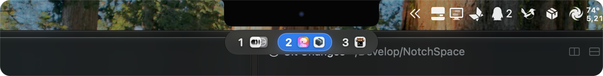
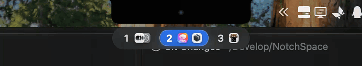

<div align="center">

# NotchSpace

**macOS 原生液态玻璃（Liquid Glass）刘海底部悬浮 Space 指示器**  
原生双后端支持 **OmniWM** 与 **Paneru** 平铺窗口管理器 · 零第三方依赖 · 自由拖拽磁吸 · 120Hz 流体缩放

-007AFF?style=flat-square&logo=apple)


<br/>



<br/><br/>



<sub>▲ 鼠标滑过连续余弦波流体放大、叠放图标扇形微展，以及切换工作区时的堆叠 → 平铺展开过渡</sub>

</div>

---

## 为什么做 NotchSpace？

使用 [OmniWM](https://github.com/OmniNull/OmniWM) 或 [Paneru](https://github.com/karinushka/paneru) 等 macOS 平铺窗口管理器时，传统状态栏方案（如 SketchyBar）往往需要接管整条系统菜单栏、维护庞大的字体图标映射表，甚至需要截图遮罩去遮挡左上角原生应用菜单。

**NotchSpace** 回归极简单一职责：**100% 保留 macOS 原生左上角应用菜单与右上角控制中心/托盘**，仅在 **MacBook 刘海正下方**（或外接显示器任意可拖拽位置）悬浮一枚纯正系统级 **Liquid Glass** 工作区胶囊，并自动识别当前运行的 `OmniWM`（通过 `omniwmctl` IPC 流）或 `Paneru` 后端。

---

## 核心特性

- **真·系统级 Liquid Glass 光学材质**
  - 基于 macOS 26/27 原生 `GlassEffectContainer` 与 `.glassEffect(.regular / .clear .interactive(), in:)` 构建，具备真实背景折射（Lensing）、边缘高光与按压弹性回馈。
  - 支持 **独立圆角液态胶囊** 与 **贴合刘海水滴延伸（Notch Chin）** 两种顶部造型平滑形变。
- **120Hz Dock 级流体悬停与堆叠展开动效**
  - `.activeAlways` 连续指针追踪：无需点击、绝不抢夺当前终端/编辑器输入焦点，鼠标滑过即呈现余弦波动态放大与跟随高光。
  - **智能叠放 vs 展开**：非当前工作区将内部多个窗口图标紧凑层叠展示（鼠标悬停时轻微扇形松开便于预览），切入当前激活工作区时顺滑平铺展开。
- **零配置真实应用图标**
  - 直接从 Paneru 状态流的 `bundle_id` 通过 `NSWorkspace` 解析任意已安装 App 的原生高清图标并内存缓存，支持一键切换 **原生彩色图标 / 去色高对比单色 / 纯数字极简模式**。
- **4 档深浅色自适应**
  - **智能自适应（默认）**：位于顶栏/刘海区时实时跟随壁纸顶栏明暗度（即使系统开浅色模式但使用深色壁纸，也能自动匹配深色玻璃亮白字）；拖至桌面窗口区时自动跟随 macOS 系统浅色/深色日夜切换。同时支持手动锁定 `System` / `Dark` / `Light`。
- **跨工作区拖拽移动任意 App（直连 Mach IPC）**
  - 在胶囊内按住任意应用图标（无论是当前工作区中的非焦点窗口，还是非激活工作区悬停扇形展开后的叠放窗口），可直接将其拖放至其他 `Space N` 或右侧动态浮现的 **`+` 新建工作区胶囊**！
  - 通过原生 Mach OOL 消息（`com.github.karinushka.paneru` + `MessagePack` `WindowSetApply`）精确按 `window_id` 调度，耗时 `< 0.1ms` 且不误移当前焦点窗口；按住 `⇧ Shift` 拖放即可携窗跟随跳转。
- **左右就近一体化液态竖条把手与状态栏垂直磁吸**
  - 鼠标靠近胶囊左侧或右侧时，主胶囊边缘会自动按指针距离向近端丝滑延展（左进则从右往左、右进则从左往右长出**一体式竖条 `|` 把手**，工作区中轴严格保持不动，悬停靠近竖条时呈现液态放大）。
  - **精准卡位与自由横滑**：除刘海正下方双向归位卡槽外，在整个状态栏区域内以及状态栏正下方均提供**上下（Y 轴）磁吸对齐轨道**，同时**左右（X 轴）保持零阻尼自由横滑**；按显示器硬件 UUID 自动记忆位置。
- **极致轻量与零轮询流式同步**
  - 纯 Swift 6 原生单二进制，零第三方依赖，常驻空闲 CPU `0.0%`；直连 `paneru subscribe --json` 事件流并自动过滤高频 `window_title_changed` 噪音。

---

## 交互手势速查

| 手势操作 | 触发行为 | 底层 Paneru 机制 |
| :--- | :--- | :--- |
| **左键单击 `Space N`** | 立即聚焦切换至第 `N` 个虚拟工作区 | `paneru send-cmd window virtualnum N` |
| **左键单击当前工作区内的非焦点图标** | 在当前平铺条带中直接聚焦并滚动至该窗口 | 原生 Mach IPC `LayoutOp::Focus(win_id)` |
| **按住任意 App 图标拖放至 `Space N` / `+`** | 将该指定窗口跨工作区移至 `Space N`（或新建工作区）；按住 `⇧` 携窗跟随 | 原生 Mach IPC `LayoutOp::MoveToWorkspace` |
| **右键单击 `Space N`** | 将当前焦点窗口发送至第 `N` 个工作区（人留原地） | `paneru send-cmd window virtualsendnum N` |
| **`⇧ Shift` + 左键 / 中键单击 `Space N`** | 携当前焦点窗口一起跳转至第 `N` 个工作区 | `paneru send-cmd window virtualmovenum N` |
| **拖动左侧 / 右侧就近延展的 `|` 竖条把手** | 自由移动悬浮窗（刘海正下卡位 + 状态栏内/下沿上下磁吸，左右丝滑横移） | 按显示器 UUID 自动保存 |
| **`⌥ Option` + 左键拖动任意位置** | 随时（含开启「锁定位置」后）强制穿锁微调悬浮窗坐标 | 绕过位置锁实时保存 |
| **右键点击 `|` 把手 / `⌥ Option` + 右键** | 呼出快捷菜单与「偏好设置…」面板（等同点击右上角菜单栏图标） | 原生 `NSMenu` / `SettingsWindow` |

---

## 编译与安装

### 环境要求
- macOS 26.0 或更高版本（推荐 **macOS 27+**）
- Swift 6.2+（Xcode Command Line Tools）
- 已安装并运行以下任一平铺窗口管理器（默认自动识别）：
  - **[OmniWM](https://github.com/OmniNull/OmniWM)**（推荐在 `~/.config/omniwm/settings.toml` 中开启 `[general] ipcEnabled = true` 并设 `[workspaceBar] enabled = false`）
  - **[Paneru](https://github.com/karinushka/paneru)**（推荐在 `~/.config/paneru/paneru.toml` 的 `[options]` 中开启 `reap_empty_workspaces = true`）

### 一键构建并安装至 `~/Applications`

```bash
git clone https://github.com/Tiomehsh/NotchSpace.git
cd NotchSpace
bash Scripts/bundle-app.sh
open ~/Applications/NotchSpace.app
```

---

## 配置文件说明

拖拽或通过「偏好设置…」修改的所有选项均实时同步至 `~/.config/notchspace/config.json`（支持外部编辑器手改保存即热重载）：

```json
{
  "version": 1,
  "appearance": {
    "colorTheme": "auto",
    "glassStyle": "clear",
    "dockedShape": "floatingCapsule",
    "iconStyle": "appIcon",
    "scale": 1.0,
    "hideEmptyWorkspaces": false,
    "activeTintHex": "#2F81F7"
  },
  "interaction": {
    "lockPosition": false,
    "enableScrollSwitch": false,
    "hideInFullscreen": false,
    "showMenuBarIcon": true,
    "snapThreshold": 8.0
  },
  "displays": {
    "<DISPLAY-UUID>": {
      "anchor": "notchOrMenuBarBottomCenter",
      "offsetX": 0.0,
      "offsetY": 4.0
    }
  }
}
```

---

## License

MIT License
